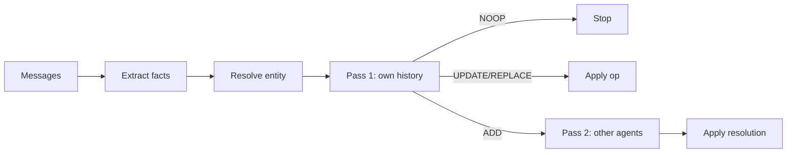

Every `memory.add()` runs a pipeline before anything is written.

## Pipeline overview



## 1. Extract

`extractFacts()` sends the **latest user/assistant turn** to an LLM. Output is validated with Zod:

```json
{ "facts": [{ "entity": "user.diet", "text": "The user is vegetarian", "type": "semantic" }] }
```

## 2. Resolve entity

Optional entity resolution aligns extractor labels to existing keys (vector similarity ± LLM disambiguation). Prevents `user.timezone` vs `user.location` drift from fragmenting memory.

## 3. Pass 1 — same agent

Vector search finds similar **active** claims from the **same** `sourceAgent`. The LLM classifies:

| Op | Meaning |
| --- | --- |
| `ADD` | New information |
| `UPDATE` | Refines without contradicting |
| `REPLACE` | Contradicts / supersedes own prior claim |
| `NOOP` | Restates existing claim — nothing written |

If pass 1 is not `ADD`, pass 2 is skipped.

## 4. Pass 2 — other agents

When pass 1 returns `ADD`, Vault searches for **active** claims on the same `entity` from **other** agents and applies the entity's resolution strategy (`recency` or `authority`).

## Search

`memory.search(query)` embeds the query, hits the vector store, hydrates rows from SQL, and applies **recency-weighted scoring** at query time. Stored `confidence` is not mutated.

Cross-agent search uses the exported `search(db, vectorStore, embed, query, opts)` with no `sourceAgent` filter.
