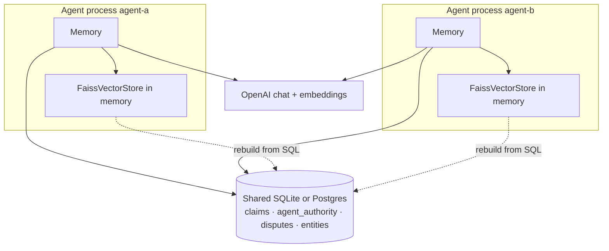
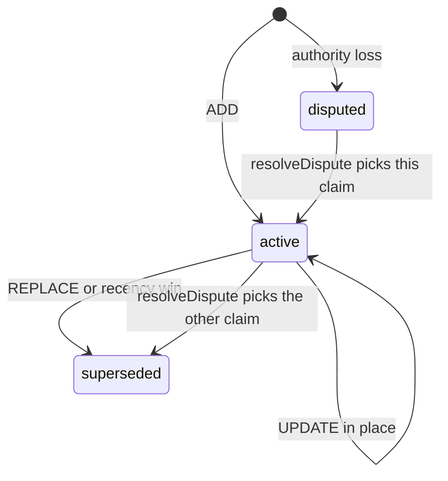
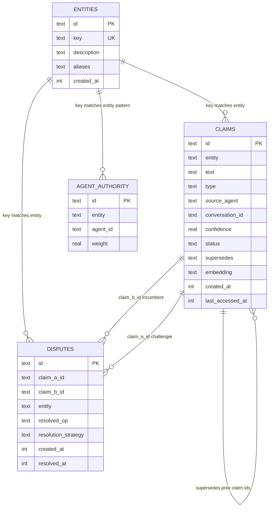
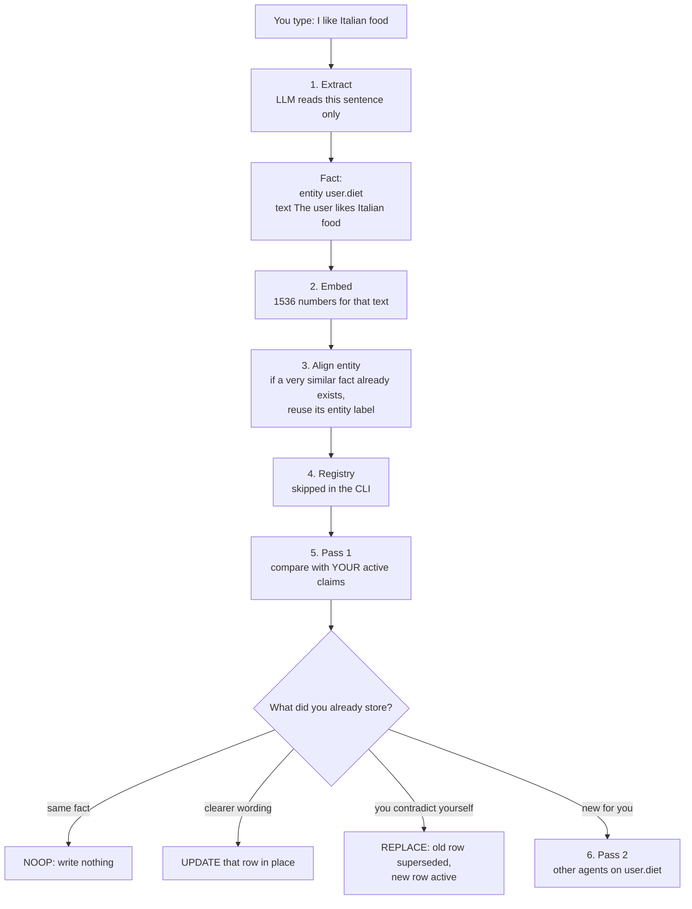
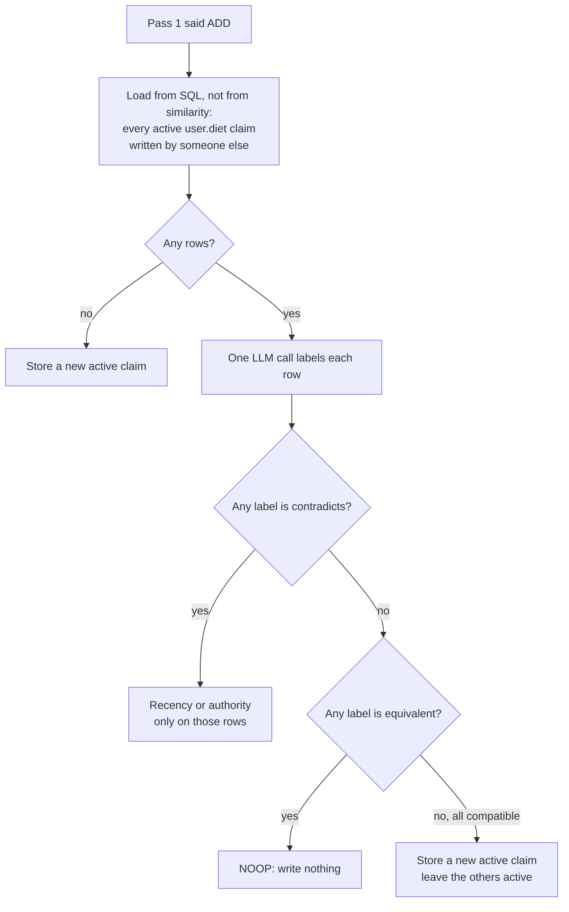
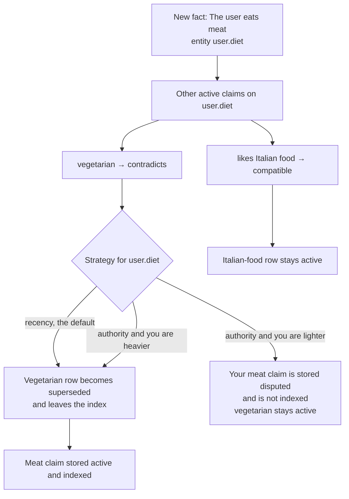

# How Vault works

Vault is a shared memory layer for AI agents. Several agents can write facts into one database. Each fact is a claim attributed to the agent that wrote it. Compatible facts on the same subject stay active together. When two agents actually contradict each other, Vault either supersedes the old claim or records a dispute.

The runnable pieces, ignoring `apps/web`, are the library `packages/vault-memory` and the demo `apps/cli-agent`.

## What lives where

- **`packages/vault-memory`** is the npm library (`vault-memory@0.2.0`). You bring a Drizzle database (SQLite or Postgres) and an OpenAI API key. Vault extracts facts, embeds them, classifies them against existing memory, and writes claim rows.
- **`apps/cli-agent`** is a two-process demo. `agent-a` and `agent-b` are separate terminals that share one SQLite file (`vault-shared.db`). Each process has its own `Memory` instance and its own in-memory FAISS index.



SQL is the source of truth. The vector index is a cache of active claims. If another process wrote claims, this process must rebuild the index before it reads or writes. The CLI does that with `syncVectorIndex()` before every command.

## The data model

A **claim** is one stored fact.

| Field | Role |
|---|---|
| `entity` | Subject key, such as `user.timezone` or `user.diet`. The extractor invents these dotted paths. |
| `text` | Standalone fact, such as "The user is in PST". |
| `type` | `semantic` (stable preference or trait) or `episodic` (a specific event). |
| `sourceAgent` | Which agent wrote it. |
| `status` | `active`, `superseded`, or `disputed`. |
| `supersedes` | JSON list of claim ids this one replaced. |
| `embedding` | JSON vector stored on the row. |
| `confidence` | Stored at `1.0`. Search ranking does not change this number. |
| `lastAccessedAt` | Updated when the claim is returned from search. Used only for ranking decay. |

Three other tables:

- **`agent_authority`** — trust weight (0–1) per agent per entity. Patterns like `user.schedule.*` are allowed. The most specific match wins. Missing weight is `0`.
- **`disputes`** — audit row when authority cannot pick a winner. `claimA` is the challenger, `claimB` is the incumbent. `resolvedAt` stays null until someone calls `resolveDispute`.
- **`entities`** — optional registry of allowed keys. Off unless `useEntityRegistry: true`. The CLI demo does not turn it on.



Only `active` claims are in the vector index. Search never returns superseded or disputed rows.

The SQLite schema does not declare foreign keys. The links below are how the code joins the rows: `disputes` points at two claim ids, `claims.supersedes` stores the ids it replaced, and `entity` / `key` are matched as strings (authority patterns may be wildcards like `user.schedule.*`).



## Writing a memory: `Memory.add`

Each agent constructs `new Memory(agentId, { db, apiKey, entityStrategies })`. `add(messages, conversationId)` only looks at the **latest user turn** plus any assistant messages after it. Older turns are ignored for extraction.

You are agent-b. The store already has one active row from agent-a: "The user is vegetarian" on `user.diet`. You type: **I like Italian food**.



**1. Extract.** The LLM returns `{ facts: [{ entity, text, type }] }`. With the registry on, the prompt lists known keys and the model must use one of them or `new:user.something`. Unknown keys without the `new:` prefix are rejected.

**2. Embed.** Default model is OpenAI `text-embedding-3-small` (1536 dimensions). That same vector is reused for entity alignment, pass 1, and the index. Pass 2 does not search by this vector.

**3. Align the entity.** The extractor often invents slightly different labels for the same subject (`user.abc` vs `user.timezone`). Vault searches all active claims by the fact vector:

- score ≥ **0.85** — adopt the existing claim's entity automatically
- **0.70–0.85** — ask the LLM whether it is the same subject
- below **0.70** — keep the extracted label

Set `entityMatchThreshold: 0` to skip this.

**4. Registry (optional).** If enabled, a valid new key is inserted into `entities` on first use (`entityRegistryAutoRegister` defaults to true).

**5. Pass 1 — this agent's own history.** Vector search returns the top 5 similar **active** claims from this agent only. The LLM then chooses:

| Op | Meaning | What gets written |
|---|---|---|
| `NOOP` | Already stored | Nothing |
| `UPDATE` | Refines wording, no contradiction | Same row updated in place. The old entity label is kept. |
| `REPLACE` | Contradicts this agent's own claim | Old row becomes `superseded` and leaves the index. New `active` row points at it via `supersedes`. |
| `ADD` | New for this agent | Continues to pass 2 |

`UPDATE` and `REPLACE` never go through cross-agent resolution. If agent-a, who wrote "The user is vegetarian", later says "I eat meat now", pass 1 returns `REPLACE`. Pass 2 never runs. The vegetarian row becomes `superseded`, and a new `active` row points at it through `supersedes`.

In the Italian-food example, agent-b has no diet claim, so pass 1 returns `ADD` and pass 2 runs.

**6. Pass 2 — other agents, same entity.** Vault loads every **active** claim whose `entity` is exactly this one and whose `sourceAgent` is someone else. This read comes from SQL, so a same-entity claim is included even when its embedding is far from the new fact. No rows means a plain `ADD`.

When rows exist, one LLM call labels each of them:

| Label | Meaning | What gets written |
|---|---|---|
| `equivalent` | The other agent already stored this fact | Nothing, if no row is `contradicts` |
| `compatible` | Both facts can be true | New `active` row. The other rows stay `active` |
| `contradicts` | They cannot both be true | Recency or authority, and only for those rows |

A `contradicts` label wins over `equivalent`. Compatible rows are left alone even when another row on the same entity is superseded or disputed.



Agent-a's vegetarian row is loaded because the entity is `user.diet` and the status is `active`. The model labels it **compatible**. Vault inserts the Italian-food row as `active` and adds it to this process's FAISS index. The vegetarian row stays `active` and searchable.

## Conflict policy

Conflict policy runs only for rows labeled `contradicts`. `entityStrategies` maps an entity (or wildcard) to `recency` or `authority`. Unlisted entities use **recency**. The most specific pattern wins, same rule as authority weights.

**Recency (default).** The new claim wins against every contradicting row. Those rows are marked `superseded` and removed from the index. The new claim is stored `active`. Compatible rows on the same entity stay `active`. No dispute row.

**Authority.** Look up weights in `agent_authority`. The incoming agent must be **strictly heavier** than every agent it contradicts. Tie or lower weight is a loss.

- Win: supersede the contradicting rows, store `active`.
- Loss: store the new claim as `disputed` and **do not index it**. Each contradicting incumbent stays `active` and searchable. A `disputes` row links the new claim to the oldest contradicting incumbent.

You later type **I eat meat now**, still as agent-b. Pass 1 is `ADD` again, because you never stored a diet fact yourself. Pass 2 labels the existing rows:



The demo seeds this:

| Entity | agent-a | agent-b | Strategy in the CLI |
|---|---|---|---|
| `user.timezone` | 0.9 | 0.2 | authority |
| `user.mood` | 0.3 | 0.8 | authority |
| everything else | — | — | recency |

Worked example: agent-a says "I'm in PST" and stores an active `user.timezone` claim. Agent-b says "I'm in EST". Pass 1 is `ADD` because agent-b has no prior timezone claim. Pass 2 loads agent-a's row and the model labels it `contradicts`. Weight 0.2 does not beat 0.9, so agent-b's claim is `disputed`. `/search what timezone is the user in?` still returns PST.

A human or app later calls `resolveDispute(db, vectorStore, disputeId, winningClaimId)`. The winner becomes `active` and indexed. The loser becomes `superseded`.

## Search

`memory.search(query)` embeds the query, searches this agent's active claims, hydrates full rows from SQL, then re-ranks.

Ranking multiplies the vector score by an exponential decay with a ~30-day half-life, based on `lastAccessedAt` (or `createdAt` if never accessed). The stored `confidence` is not changed. Returned claims then get `lastAccessedAt` bumped, so frequently used facts rank higher next time.

The CLI's `/search` does not use `memory.search`. It calls `searchSharedStore`, which searches **all agents'** active claims. That is the shared view of "what does the store currently believe."

FAISS uses `IndexFlatIP` (exact inner product). Vectors are L2-normalized first, so inner product equals cosine similarity. Filters (agent, entity, status) are applied in JavaScript after a slightly larger candidate pull. There is also `MemoryVectorStore` (pure JS cosine, for tests) and `PgVectorStore` (`vault-memory/pg`) when Postgres plus pgvector should be the shared index instead of a per-process FAISS cache.

## How the CLI wires it

1. `agent-a.ts` / `agent-b.ts` call `runCli` with a fixed agent id and `vault-shared.db`.
2. `createDb` opens SQLite and creates `claims`, `agent_authority`, and `disputes` if missing. The `entities` table is not created here.
3. `bootstrapSharedStore` inserts the authority seed once, if the authority table is empty.
4. `createAgentMemory` builds one `Memory` plus one `FaissVectorStore`, and sets timezone and mood to `authority`.
5. The readline loop:
   - plain text → `memory.add` after rebuilding the index
   - `/search` → shared search across agents
   - `/claims` and `/disputes` → dump SQL rows
   - the "assistant" reply is only a receipt of what was stored. This demo does not run a chat model over the memories.

Because each process owns its FAISS index, a write in terminal 1 is invisible to terminal 2 until terminal 2 rebuilds from SQLite. That rebuild is why the CLI calls `vectorStore.rebuild(db)` before every add and search.

## What you would call from your own agent

```typescript
const memory = new Memory("agent-a", {
  db,                              // Drizzle over SQLite or Postgres
  apiKey: process.env.OPENAI_API_KEY,
  entityStrategies: { "user.timezone": "authority" },
});

await memory.add(
  [{ role: "user", content: "I'm vegetarian" }],
  "conversation-1",
);

const hits = await memory.search("what does the user eat?");
```

`update` and `delete` only touch claims whose `sourceAgent` is this agent, and they keep the vector index in sync. Cross-agent search is the exported `search()` function with no `sourceAgent` filter.
